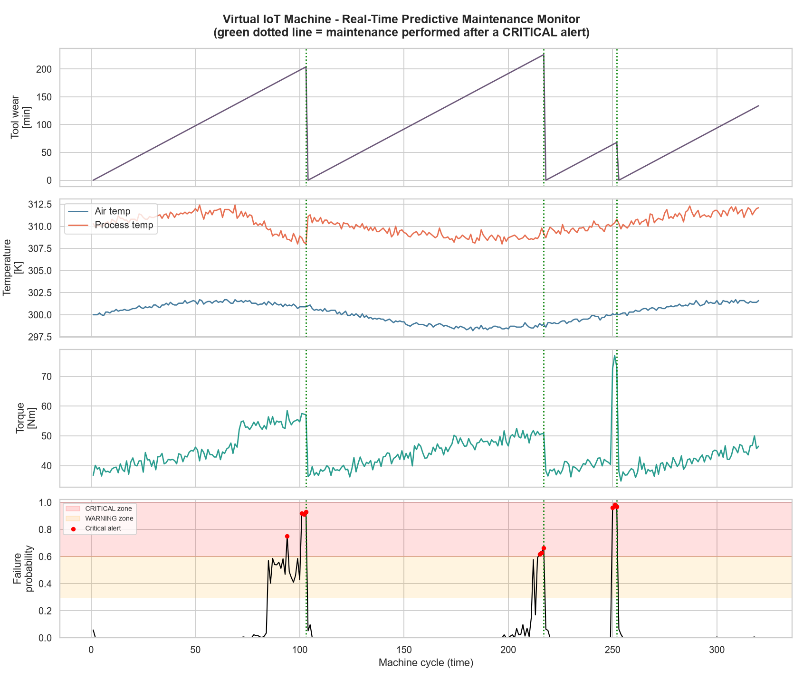
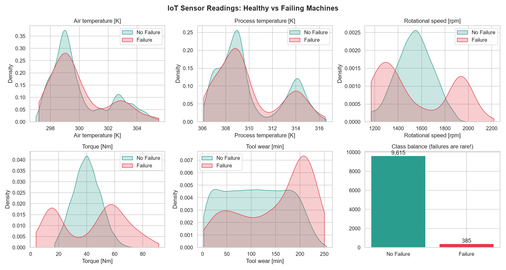
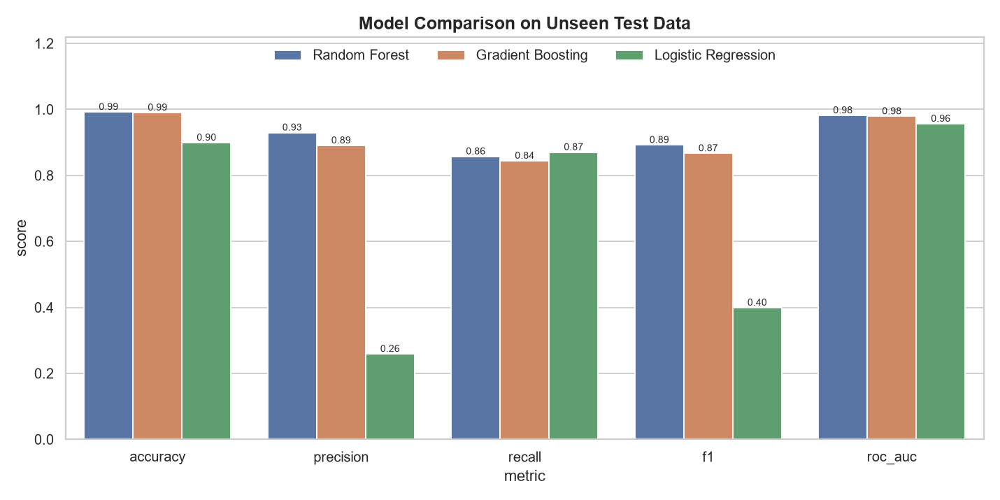
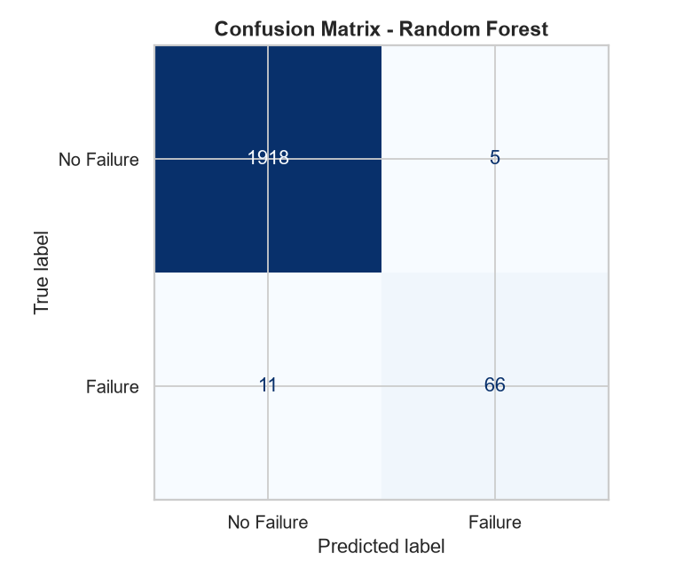
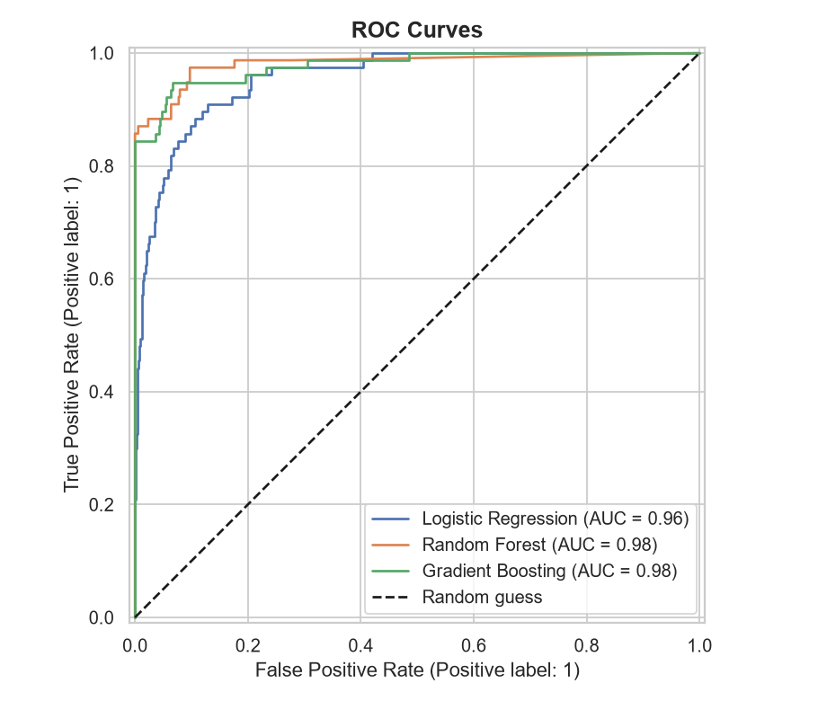
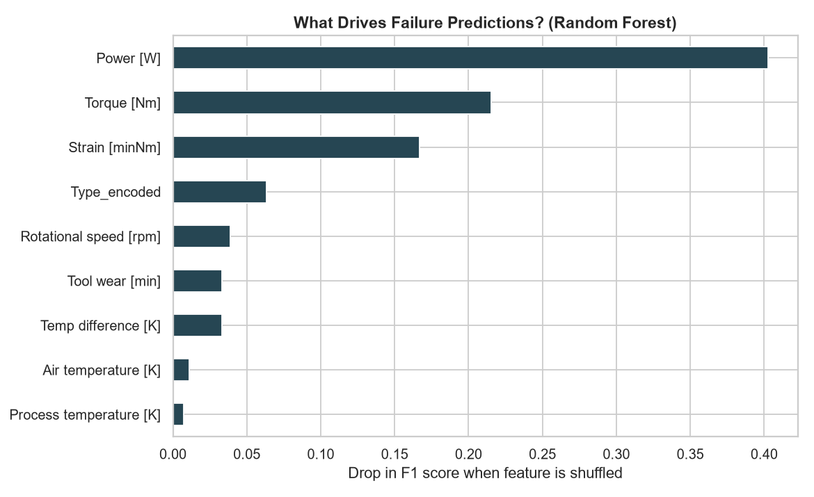
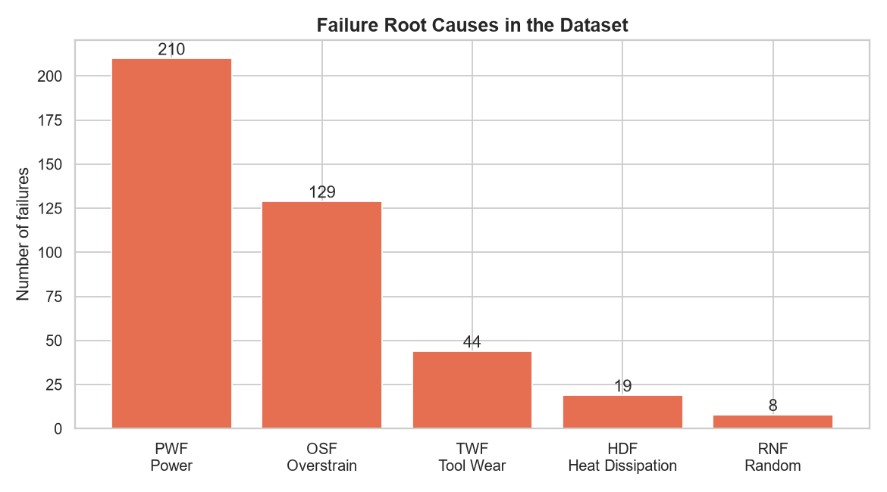

# 🏭 AI-Powered Predictive Maintenance System for IoT Devices

> Predict industrial machine failures **before they happen** using IoT sensor data and Machine Learning, with a real-time virtual machine simulation, an automated alert system, and root-cause hints.




---

## 📌 Overview

Unplanned machine breakdowns cost manufacturers an estimated **$50 billion per year**. This project builds an end-to-end **predictive maintenance** pipeline that:

1. **Simulates a fleet of IoT-connected milling machines** (temperature, speed, torque and tool-wear sensors)
2. **Cleans and engineers physics-based features** (power, heat dissipation, tool strain)
3. **Trains and compares 3 ML models** (Logistic Regression, Random Forest, Gradient Boosting)
4. **Predicts failure / no failure** with a probability score
5. **Generates NORMAL / WARNING / CRITICAL alerts** with likely root cause and recommended action
6. **Streams a live virtual machine** that the model monitors in real time, triggering maintenance before breakdown

## ❓ Problem Statement

Factories traditionally use **reactive maintenance** (fix after it breaks, which means costly downtime) or **preventive maintenance** (service on a fixed schedule, which wastes healthy parts).
**Goal:** use sensor data to predict *which machine will fail* and *why*, so maintenance happens **just in time**.

## 🏗️ Industry Relevance

| Industry | Use case |
|---|---|
| Manufacturing / CNC | Tool-wear and spindle failure prediction (this project) |
| Power plants | Turbine vibration and temperature anomaly detection |
| Automotive | Assembly-line robot health monitoring |
| Aviation | Jet engine Remaining Useful Life (RUL) estimation |
| Oil & gas | Pump and compressor failure prediction |

Similar systems are used commercially by Siemens MindSphere, GE Predix, AWS Monitron and Azure IoT.

## 🛠️ Tech Stack

| Layer | Tools |
|---|---|
| Language | Python 3.10+ |
| Data processing | Pandas, NumPy |
| Machine learning | Scikit-learn (Logistic Regression, Random Forest, HistGradientBoosting), Joblib |
| Visualization | Matplotlib, Seaborn |
| Testing | Pytest |
| Exploration | Jupyter Notebook |

## 📊 Dataset

The structure follows the **UCI AI4I 2020 Predictive Maintenance Dataset**, a widely used benchmark that models a real milling machine.

- **Default:** `src/data_simulator.py` generates 10,000 realistic sensor records using the same physical failure rules, so **no download is needed**.
- **Optional:** download the real dataset from the [UCI repository](https://archive.ics.uci.edu/dataset/601/ai4i+2020+predictive+maintenance+dataset), save it as `data/raw/ai4i2020.csv`, and the pipeline uses it automatically.

| Sensor | Unit | Meaning |
|---|---|---|
| Air temperature | K | Ambient temperature |
| Process temperature | K | Machining temperature |
| Rotational speed | rpm | Spindle speed |
| Torque | Nm | Load on spindle |
| Tool wear | min | Cutting-tool usage time |

**Failure modes:** Tool Wear (TWF), Heat Dissipation (HDF), Power (PWF), Overstrain (OSF), Random (RNF). About 3.9% of cycles fail, which makes this a highly **imbalanced** problem.

## 🧩 Architecture

```
 ┌──────────────────┐   ┌──────────────┐   ┌─────────────────────┐   ┌──────────────────┐
 │ IoT Sensors      │──▶│ Preprocessing│──▶│ Feature Engineering │──▶│ ML Model         │
 │ (simulated)      │   │ dedupe, fix  │   │ Power, Temp diff,   │   │ Random Forest    │
 │ temp/rpm/torque/ │   │ glitches,    │   │ Strain, Type enc.   │   │ (best of 3, CV)  │
 │ tool wear        │   │ drop leakage │   └─────────────────────┘   └────────┬─────────┘
 └──────────────────┘   └──────────────┘                                     │ failure probability
                                                                              ▼
 ┌──────────────────────────┐   ┌────────────────────────────────────────────────────────┐
 │ Visualization Dashboard  │◀──│ Alert System: NORMAL (<30%) │ WARNING │ CRITICAL (≥60%) │
 │ images/*.png             │   │ + root-cause diagnosis + action + CSV alert log         │
 └──────────────────────────┘   └────────────────────────────────────────────────────────┘
```

## 📁 Project Structure

```
AI-Predictive-Maintenance-IoT/
├── data/
│   ├── raw/                   # simulated_sensor_data.csv (or real ai4i2020.csv)
│   └── processed/             # cleaned + engineered features (auto-generated)
├── notebooks/
│   └── 01_exploratory_data_analysis.ipynb
├── src/
│   ├── config.py              # all paths and settings
│   ├── data_simulator.py      # virtual IoT sensor fleet
│   ├── data_loader.py         # load real or simulated data
│   ├── preprocessing.py       # cleaning
│   ├── feature_engineering.py # physics-based features
│   ├── model_training.py      # train + cross-validate 3 models
│   ├── evaluation.py          # accuracy/precision/recall/F1/ROC-AUC
│   ├── predict.py             # predict on new readings
│   ├── alert_system.py        # alert levels + root cause
│   ├── iot_stream_simulator.py# real-time machine monitoring
│   └── visualization.py       # all charts
├── models/best_model.joblib   # trained model
├── outputs/                   # metrics, predictions, logs
├── images/                    # charts used in this README
├── docs/PROJECT_GUIDE.md      # full step-by-step guide
├── tests/test_pipeline.py     # unit tests
├── main.py                    # one entry point for everything
├── requirements.txt
└── README.md
```

## ⚙️ Installation

```bash
git clone https://github.com/SNischayPrasad/AI-Predictive-Maintenance-IoT.git
cd AI-Predictive-Maintenance-IoT
python -m venv venv
# Windows:   venv\Scripts\activate
# Mac/Linux: source venv/bin/activate
pip install -r requirements.txt
```

## 🚀 Usage

```bash
python main.py                  # full pipeline (about 1-2 minutes)
python main.py simulate         # generate sensor dataset only
python main.py train            # train, evaluate, create charts
python main.py stream           # real-time virtual machine monitoring
python main.py stream --delay 0.2   # slower "live" output for screen recording
python main.py predict --type L --air 300 --process 310.5 --rpm 1380 --torque 58 --wear 215
pytest                          # run unit tests
```

Example prediction output:

```
[CRIT] CUSTOM-MACHINE | failure risk 96.0% | CRITICAL -> STOP machine and perform maintenance immediately
        cause: Tool nearly worn out -> replace cutting tool; Tool overstrain -> reduce load or replace tool
```

## 📈 Results

Test set: 2,000 unseen machine cycles, 77 of them real failures.

| Model | Accuracy | Precision | Recall | F1 | ROC-AUC |
|---|---|---|---|---|---|
| **Random Forest (selected)** | **0.992** | **0.930** | **0.857** | **0.892** | **0.982** |
| Gradient Boosting | 0.990 | 0.890 | 0.844 | 0.867 | 0.979 |
| Logistic Regression | 0.899 | 0.259 | 0.870 | 0.399 | 0.956 |

- The selected model **caught 66 of 77 failures** with only **5 false alarms** out of 1,923 healthy cycles.
- Logistic Regression has high recall but raises 192 false alarms: failure zones are **non-linear** (failures happen at both very low *and* very high power), so tree models win.
- Most important features: **Power, Torque, Tool strain**. These are the engineered physics features.
- In the live simulation the model detected a **cooling fault, a worn tool and a motor overload**, and triggered **3 maintenance actions before breakdown**.

> ⚠️ Honest note: the data follows known physical rules, so scores are higher than on noisy real plant data. The point of the project is the end-to-end engineering pipeline.

## 🖼️ Screenshots

| Sensor distributions | Model comparison |
|---|---|
|  |  |
| **Confusion matrix** | **ROC curves** |
|  |  |
| **Feature importance** | **Failure root causes** |
|  |  |

## 🎓 Learning Outcomes

- Handling **imbalanced** classification (class weights, stratified split, recall/F1 over accuracy)
- **Domain-driven feature engineering** (mechanical power, heat dissipation, strain)
- Avoiding **data leakage** (dropping failure-mode labels and IDs)
- **Model selection with cross-validation** while keeping the test set untouched
- Converting ML output into **business actions** (alert thresholds, root-cause hints)
- Building **modular, tested, reproducible** Python projects

## 🔮 Future Improvements

- LSTM / time-series models on NASA C-MAPSS turbofan data for Remaining Useful Life
- Streamlit live dashboard
- MQTT broker + Raspberry Pi / ESP32 for real sensor ingestion
- REST API with FastAPI and a Docker deployment
- SHAP explanations for each prediction

## 📚 References

- S. Matzka, "Explainable Artificial Intelligence for Predictive Maintenance Applications," AI4I 2020, IEEE.
- UCI Machine Learning Repository: AI4I 2020 Predictive Maintenance Dataset.

## 👤 Author

**Nischay**: [GitHub](https://github.com/SNischayPrasad) · [LinkedIn](https://linkedin.com/in/<your-profile>)

⭐ If you found this useful, consider giving the repo a star!
